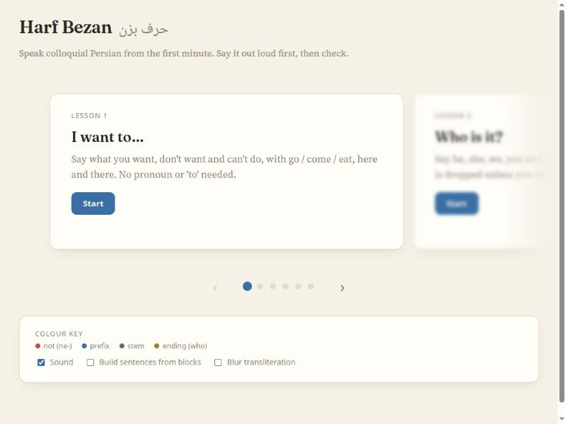
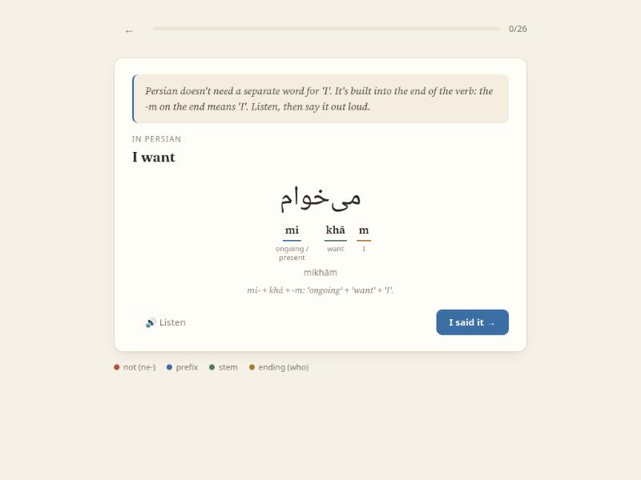
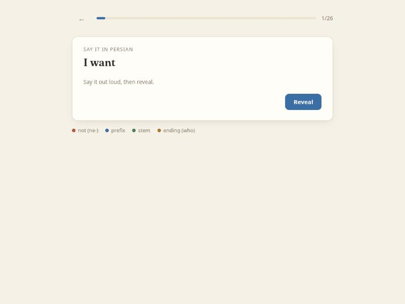

# Harf Bezan · حرف بزن

A course in colloquial Persian: build sentences from a few pieces, say them out loud before the answer appears, grammar focused, no memorising lists. The visual layer
colour-codes the pieces (negative / prefix / stem / ending) so the grammar shows up as a pattern.

  
  
  

## Run it
    ./serve.sh            # then open http://localhost:8000
    # audio (optional but expected): see udio.py; --sample compares voices first

Static, no build step (plain ES modules).
Flow: teach beat -> say it aloud -> reveal -> "Got it" / "Not yet" (misses come back once at the end).
Settings: sound, build-sentences-from-blocks mode, blur transliteration (progress/settings in localStorage).

## Lessons
1. I want to… (want / can, go-come-eat, here/there) 2. Who (all persons) 3. Now and tomorrow (present as near future, dāram)
4. Yesterday (past) 5. Questions and requests (intonation, kojā/chi/cherā/key, mishe) 6. Must, need and joining sentences (bāyad, vali, chon, va, yā)
Each lessons/lNN.notes.md lists forms the drafter was unsure of: check those with a native speaker before publishing.
Audio: ~247 clips (a few steps use "voice": "farid"); run scripts/generate_audio.py once, it only generates missing files.

## Layout
- `index.html`, `app.js`, `style.css`  the viewer.
- `lessons/index.json` lists lesson ids; `lessons/l01.json`  lesson data. Steps are `teach`, `prompt` or `review`.
- `scripts/generate_audio.py`  edge-tts audio (same voice as noghteh); `--sample` compares Dilara vs Farid.
- `audio/<step id>.mp3`  generated, keyed by stable step id (never renumber ids once published).

## Conventions
- Colloquial spelling, with ZWNJ in می‌/نمی‌ (so TTS and rendering are right): می‌خوام, not می‌خواهم.
- Transliteration matches noghteh (ā, ū, ī).
- Morpheme `parts` are shown in transliteration only; Persian script is displayed whole because
  splitting joined letters breaks their shaping.

## Next
1. Run `--sample`, listen, decide on voice(s) and whether any phrases need re-recording.
2. ~~Static viewer~~ done (v0). Ideas: slow audio, spaced repetition across lessons, a progress map.
3. Lesson 2: tense/person swaps (he/she/we) reusing the same slots.
